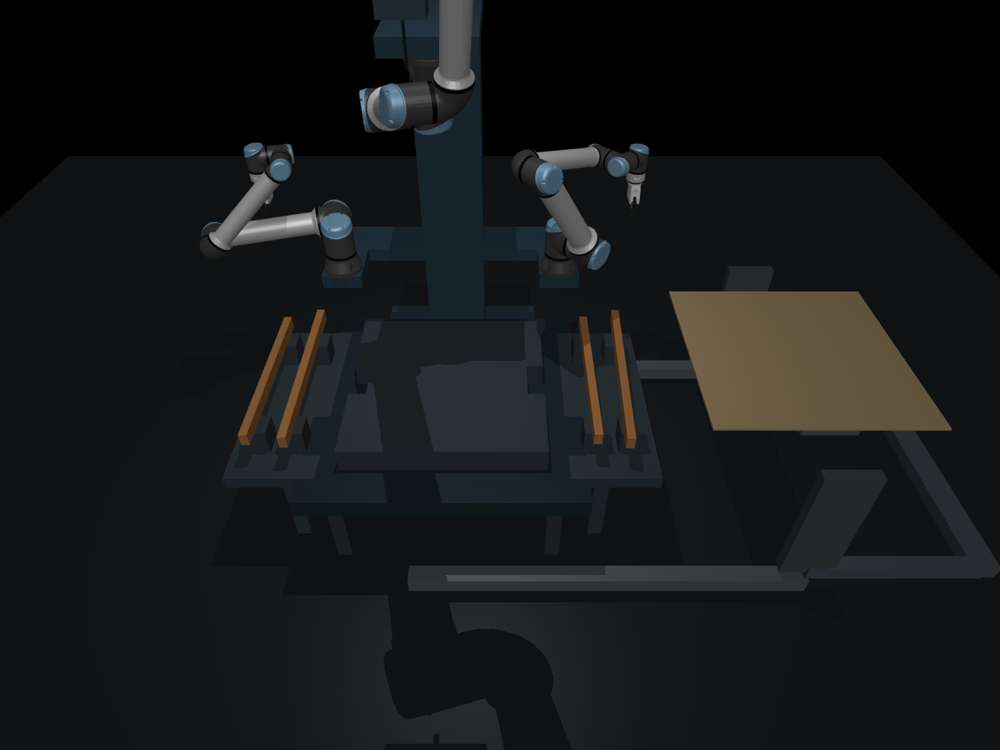

# Camera-controlled frame assembly: research snapshot

Three arms on one static torso assemble four lumber members into a flat frame,
place a sheet over it, attempt eight nail connections, and lift/flip the assembly.
Two arms carry grippers; the third carries a fastening tool. MuJoCo provides
contact dynamics and provisional breakable fasteners.

This repository preserves the current environment, its frozen supervisory
benchmark, measurement protocols, tests, and available evidence. **It is not a
validated real-world assembly policy. No distillation or RL has been applied to
this benchmark.**

## Small code-as-policy RL experiment (2026-10-22)

A separate [CaP-RL-style experiment](experiments/cap_rl/README.md) now trains
Qwen2.5-Coder-1.5B to generate programs for a discrete pick-and-place task. On 128
untouched coordinate layouts, strict success improved from **4/128 (3.1%) to
121/128 (94.5%)** after 120 GRPO updates on one 24 GB GPU. All 256 before/after
test programs passed an independent execution replay audit.

[Results, learning curve, checkpoint, and reproduction instructions](results/cap_rl/2026-10-22/README.md).
This is one training seed on a symbolic coordinate task. It does **not** establish
RL improvement on the camera-controlled MuJoCo frame assembly benchmark below.



## What is actually being compared?

Qwen3.5-4B and Codex configured for `gpt-6-astra` select from the **same fixed
feedback skills** using three RGB views, camera calibration, a blueprint, robot
encoders, and command history. Skills implement perception, grasping, motion,
placement, fastening and flipping. Runtime workpiece truth and joint condition
are evaluator-only.

The benchmark measures supervisory skill selection and visual checking. It does
**not** compare generated code with direct end-effector prediction, establish that
the model needs images, or isolate model capability from serving hardware. A
scripted sequence also completes a development layout. Known geometry, surveyed
supports, material segmentation and no-slip/stationary-object assumptions remain
strong priors.

## Current results, as preserved on 2026-10-21

| Trial | Strict result | Observed outcome |
|---|---|---|
| Codex/Astra, 23001 | Fail | Completed visible assembly and flip; 6/8 fasteners intact after two insertion misses |
| Codex/Astra, 23002 | Fail | Completed visible assembly and flip; 7/8 fasteners intact after one insertion miss |
| Codex/Astra, 23003 | Fail | Stopped during sheet lowering at 0.542 mm penetration; limit is 0.5 mm |
| Qwen, 23001 | Fail | First inference request exceeded 120 s; no action returned |
| Qwen, 23002 | Fail | First inference request exceeded 120 s; no action returned |
| Qwen, 23003 | Incomplete | Driver selected this case, but no saved observation or result exists |

There are **five completed trial records**, not six. The incomplete case is
tracked separately; it is not a success, a measured timeout, or a completed pair.
The observed rates among completed records are 0/3 and 0/2. These tiny samples,
different inference routes, and censored Qwen requests do not establish model
superiority. A delayed scripted development regression passed; it is not a model
result. See [the result interpretation](docs/RESULTS.md).

[Videos and available raw evidence](https://github.com/AlmondGod/is-rvlmrl/releases/tag/research-snapshot-2026-10-21)
include a scripted development success, an Astra run that visibly finishes but
fails acceptance, and the penetration failure. Videos alone are not acceptance.
Two pilot trace files were already absent at packaging; the evidence inventory
explicitly records that gap.

## Run it

Use Python **3.12.9** for the exact historical runtime:

```bash
python3.12 -m venv .venv
source .venv/bin/activate
python -m pip install -r requirements.txt
python -m unittest experiments.assembly_benchmark.test_benchmark \
  experiments.torso_assembly.test_flip \
  experiments.torso_assembly.test_fasteners \
  experiments.torso_assembly.test_blind_pose \
  experiments.torso_assembly.test_multiview_pose \
  experiments.torso_assembly.test_contracts \
  experiments.arm_corner.test_contracts
python scripts/restore_frozen.py --out runtime/frozen_v9
```

The tests cover the current benchmark and its supporting geometry/contracts.
Run the simulation from the reconstructed bundle, with outputs outside it.
[Reproduction instructions](docs/REPRODUCING.md) include a model-free smoke test,
a full scripted demonstration, model endpoints, and independent replay audits.
Rendering was checked on macOS; a headless Linux machine needs an appropriate
MuJoCo EGL/OpenGL setup. No cloud provider is required for simulation.

The historical Codex adapter is pinned to a specific macOS CLI binary and model
alias. It deliberately refuses a different executable. Access to that model is
not distributed with this repository. Qwen serving runs separately and needs the
official model weights, also not included.

## Repository map

| Path | Contents |
|---|---|
| `experiments/assembly_benchmark/` | Frozen protocol, model interface, providers, continuous simulation runner, evaluation and tests |
| `experiments/torso_assembly/` | Three-arm embodiment, RGB estimation, feedback skills, breakable fasteners and flip |
| `experiments/{frame_assembly_v2,wall_panel,arm_corner}/` | Supporting environments, geometry and controllers |
| `experiments/{astra_camera,box_assembly}/` | Reused perception/fastening utilities and earlier measurement protocols |
| `provenance/` | Exact source manifest, runtime versions and model-weight checksums |
| `results/` | Public observations, responses, metrics, prior audit reports and retained historical failures |
| `analysis/`, `scripts/` | Post-hoc analysis, snapshot reconstruction and replay helpers |
| `third_party/` | Required robot descriptions, meshes and their original licenses |

The seven source packages are preserved byte-for-byte from v9, including legacy
utilities. **Not every legacy entry point is self-contained:** old Wuji-hand
experiments require omitted hand assets and packages; the old standalone
wall-panel test expects a historical frame checkpoint. These are not dependencies
of the current torso benchmark. Earlier H2/point-track, ResiP and hand-policy
campaigns are outside this snapshot. Old rail-RL files retained in a dependency
package are not evidence that the current benchmark was trained with RL.

## Evidence boundaries

- **Software:** frozen source, tests and recorded trials are available.
- **Numerics:** development checks and raw-state audits exist, with incomplete
  historical trace retention and a held-out penetration failure explicitly reported.
- **Simulated competence:** a scripted development layout passes; no completed
  model pilot meets all frozen acceptance criteria.
- **Physical transfer:** unvalidated. Fasteners, grip, wood, tool and mounting
  parameters need measurements. Glue models in the earlier box work are not
  integrated into this benchmark.

See [limitations and development evidence](docs/RESULTS.md),
[third-party provenance](THIRD_PARTY_NOTICES.md), and the original
[nail/flip protocol](experiments/torso_assembly/nail_flip_protocol.txt).
No new license for first-party code is asserted in this snapshot; third-party
licenses remain in force for their respective files.

