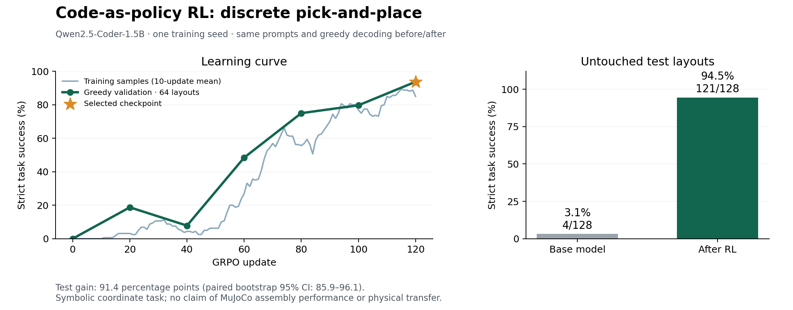

# CaP-RL-style code-generation result — 2026-10-22

**Qwen2.5-Coder-1.5B-Instruct improved from 4/128 (3.125%) to 121/128
(94.53125%) successful programs on untouched test layouts.** This is a small
code-as-policy proof of concept on a discrete coordinate task, not an improvement
claim for the repository's full MuJoCo assembly benchmark.



## Measurement

| Metric | Base model | Selected RL adapter |
|---|---:|---:|
| Strict test success | 4/128 (3.1%) | 121/128 (94.5%) |
| Executable, non-truncated test programs | 10/128 (7.8%) | 127/128 (99.2%) |
| Mean shaped test reward | 0.0510 | 0.9670 |
| Validation success | 0/64 | 60/64 (93.75%) |

The paired test comparison has **117 wins and zero losses**. The absolute success
gain is **91.40625 percentage points**; a paired bootstrap over the 128 layouts
(10,000 resamples) gives a 95% interval of **[85.9375, 96.09375] points**.
This interval does not account for variability between training seeds.
Seven trained programs still fail: six place at the wrong cell and one moves
outside the board. All failures are retained in the raw report.

Both models use identical prompts, greedy decoding, a 96-token completion budget,
and the same AST interpreter and strict success rule. The step-120 adapter was
selected solely by validation success, with validation reward as a tiebreaker.
The final test set was evaluated only after selection; no subsequent training or
parameter changes used the test outcomes. There are no teacher demonstrations,
SFT warmup, supplied solutions, or oracle calls in training.

## What was trained

The task is to generate up to eight calls to `move(dx, dy)`, `pick()`, and
`place()` on a 5 × 5 board. Observations contain exact integer coordinates.
Movements are relative. Execution rewards favor approach, pickup, transport,
and successful release at the target. The model produces the code; the executor
does not repair incorrect movement offsets or inject a solution.

- Model revision: `2e1fd397ee46e1388853d2af2c993145b0f1098a`.
- One NVIDIA RTX PRO 4000 Blackwell, 24 GB; PyTorch 2.8.0+cu128; Python 3.12.
- LoRA rank 16, alpha 32, all linear layers; 18,464,768 trainable parameters.
- 120 GRPO updates; two prompts × eight sampled programs per update; 1,920
  generated training programs spanning 149 distinct layouts from a 256-layout pool.
- Training seed 42; learning rate 0.0001; KL coefficient 0.02; gradient clip 1.0.
- Temperature 1, no top-k/p filtering or repetition penalty; no dropout.
- The training loop took 942 seconds, including intermediate validation but
  excluding model loading, initial baseline evaluation, and final test evaluation.

The method adapts [CaP-RL from CaP-X](https://github.com/capgym/cap-x) to a small
single-GPU implementation. It does not use the upstream VeRL/Franka stack.
The discrete task does not measure images, contact dynamics, collision avoidance,
continuous motor control, real robots, general Python competence, or transfer to
unseen task families. This is one training seed and in-distribution generalization
to different coordinate combinations. Broader conclusions need new experiments.

## Reproduce

Install CUDA-compatible PyTorch and the separate experiment dependencies; do not
use the historical simulator's dependency lock for this experiment.

```bash
python3.12 -m venv .venv-cap
source .venv-cap/bin/activate
pip install torch==2.8.0 --index-url https://download.pytorch.org/whl/cu128
pip install -r experiments/cap_rl/requirements.txt
python -m unittest experiments.cap_rl.test_task experiments.cap_rl.test_grpo \
  experiments.cap_rl.test_audit
python -m experiments.cap_rl.train train --out outputs/cap_rl/reproduction \
  --model Qwen/Qwen2.5-Coder-1.5B-Instruct \
  --revision 2e1fd397ee46e1388853d2af2c993145b0f1098a \
  --seed 42 --steps 120 --group-size 8 --prompts-per-step 2 --microbatch 2 \
  --max-tokens 96 --eval-every 20 --lr 0.0001 --beta 0.02
python -m experiments.cap_rl.train test --out outputs/cap_rl/reproduction
python -m experiments.cap_rl.audit outputs/cap_rl/reproduction
```

CUDA/library differences can change exact sampled trajectories; reproduce the
protocol and compare recorded outcomes rather than assuming bitwise equivalence.

The [checkpoint release](https://github.com/AlmondGod/is-rvlmrl/releases/tag/cap-rl-codegen-2026-10-22)
contains `cap-rl-run03.tar.gz`: selected adapter, tokenizer, metadata, original
training source, all rollout records, evaluations, and base-model license.
It does not include the base weights, which the loader obtains from the pinned
Qwen model revision. Extract it into an output directory and pass the resulting
`run03` directory to `experiments.cap_rl.demo`. The base model is Apache-2.0;
its license is included in the bundle.

Bundle SHA-256:
`d9d9306e7fea58721f2f5041f24ad2cce30a397584067b7f4d9777c70d4d0b3c`.

## Evidence and checks

- [Complete test programs and metrics](run03/test_comparison.json).
- [Replay audit](run03/audit.json): all 256 programs independently re-executed,
  with prompts, outcomes, rewards, traces, case identities, and totals checked.
- [Checkpoint selection](run03/selection.json), [metadata and source hashes](run03/metadata.json),
  [training metrics](run03/training.jsonl), and [all sampled programs](run03/rollouts.jsonl.gz).
- [13 passing tests](run03/tests.log), including gradient direction, EOS/padding,
  rejection of arbitrary code, and detection of falsified/duplicated results.
- [Original training source](run03/source/), verified byte-for-byte against the
  implementation in commit `237693e`. The remote checkout still reported its
  original base commit in metadata; the recorded source hashes identify what ran.
- [Observed runtime packages](runtime-freeze.txt). This is an environment inventory,
  including unused preinstalled packages, not a portable install requirements file.
- `run01/` and `run02/` preserve failed 0.5B development attempts and their exact
  source. The first learned a syntax-reward shortcut; the second found no positive
  rewards. Both also inherited a repetition penalty incompatible with the raw
  policy log probabilities. Their results are not valid GRPO success claims.

The experiment package's README records the full task and split protocol.
`analysis/cap_rl_report.py` reproduces the chart with Matplotlib 3.10.7.

An illustrative corrected test program (`4f7fb8a4536d04f9`) starts with gripper
at (0, 0), member at (-2, 0), and target at (0, -2). The base model emits
`move(-2, 0); pick(); move(0, -2); place()`, placing at (-2, -2). The trained
model changes the second move to `move(2, -2)`, correctly reaching (0, -2).
This example is illustrative; the headline score includes all 128 cases.
