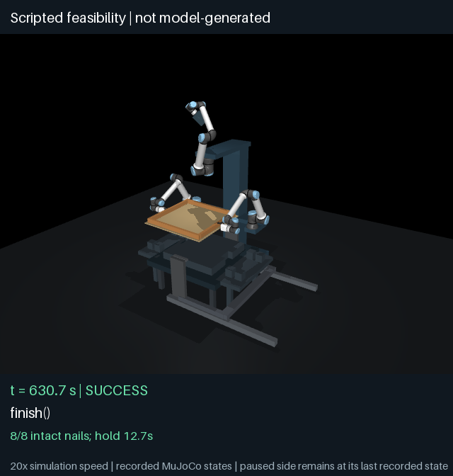

# Qwen3.5-4B full three-arm assembly pilot

Status: the physical training integration is implemented and the pilot is in
progress. **No trained-model full-task success or held-out improvement is
claimed yet.** The historical live visual-language benchmark remains unchanged.

The task starts with four loose frame members and a loose plywood sheet. Three
torso-mounted UR10e arms place the members, make four frame connections, feed and
place the sheet, make four sheet connections, then lift and flip the assembly.
The model writes a complete program using supplied RGB/encoder feedback skills;
it does not receive images or hidden workpiece state and does not learn motors.

[Task, reward, splits, training budget and reproduction](../../../experiments/cap_rl/ASSEMBLY_TASK.md).
Use [requirements-cap-assembly.txt](../../../requirements-cap-assembly.txt) for
this pilot; it retains the full simulator's NumPy 2.5.4 pin alongside the Qwen
dependencies, rather than the older single-rail runtime's NumPy 2.5.2 pin.

## Completed development checks

The scripted reference completed development seed 3 in **630.70 simulated
seconds / 1,003.02 wall seconds** on macOS. It passed the existing independent
full-task gates with **8/8 intact fasteners**, **12.74 seconds inverted hold**,
**0.430 mm peak penetration** (limit 0.5 mm), **0.831 mm peak airborne relative
displacement**, and **1.351 degrees peak relative angle**. This is a scripted
feasibility result, not model inference or an RL result. No physics, nail strength
or acceptance threshold was relaxed. Its exact 227 source/asset files were
reconstructed against the recorded hashes for preservation.

The same scripted reference **fails training layout 41001** on the GPU host:
it finishes the motion but retains only **7/8 fasteners**. The first corner
connection is missed. A post-hoc ray test at recorded states near that trigger
finds a **6.280 mm material gap along the nail ray**, exceeding the unchanged
6 mm insertion limit. This diagnostic does not feed state or answers to the
model. The failed full run is preserved in `development/train41001`; it took
626.90 simulated seconds and 1,970.40 wall seconds. The single successful
development layout therefore does not establish controller reliability across
randomized layouts, and valid program sequencing alone may not solve every case.

Qwen3.5-4B's initial greedy program picks all four members before releasing any.
The second call tries to pick up another member with an occupied gripper. The
physical executor rejects it with `Arm already carries a member`. The GPU smoke
check produced finite nonzero LoRA gradients and used **14.06 GiB peak allocated
memory** on the new 24 GB RTX PRO 4000 Blackwell.

The new language/reward tests and inherited benchmark, geometry, perception,
fastener and flip tests pass: **54 tests** on the GPU host. A separate parallel
regression compares physical grasp trajectories and failure results against
sequential execution at absolute tolerance **1e-7**, including AST-equivalent
batch deduplication.

The first sequential preparation run was stopped with **zero optimizer updates**
to improve simulation throughput. Its partial baseline records are retained.
The replacement uses four independent physics workers and 32 GRPO updates,
two layouts × four samples per update (256 programs). Eight training layouts,
four validation layouts and eight untouched test layouts are predeclared.
Test evaluation must wait until validation-based selection is final.

Model weights: `Qwen/Qwen3.5-4B` revision
`851bf6e806efd8d0a36b00ddf55e13ccb7b8cd0a`, raw initialization, non-thinking mode,
rank-16 all-linear LoRA. This does not continue the single-rail adapter.

The cached model files on the mounted volume were unreadable; the same pinned
official weights were downloaded to local pod storage. The failed setup log is
retained separately and no optimizer update occurred during that failure.

## First learning update (interim evidence)

The first optimizer update completed with a finite nonzero gradient (norm
0.15794); mean sampled reward was 0.15469 and strict success was 0/8.
The correctly interleaved full program on layout 41001 earned 0.61875 but retained
7/8 fasteners. An independent execution of its identical call sequence matches
all 6,270 recorded states exactly (maximum difference zero). The comparison
records the wrapper/helper source differences; physics, controllers, assets and
runtime match. This is not presented as an identical-full-provenance audit.

On layout 41002 the same sampled sequence placed all four rails and inserted all
four frame fasteners, then failed the unchanged numerical gate during plywood
positioning: peak penetration 0.755 mm versus a 0.5 mm limit. Reward is zero.
Its program and compact result are preserved in `initial-training`. The terminal
contact diagnostic is a post-hoc measurement; the peak occurred within an
integration substep and cannot be attributed to a particular contact from the
saved terminal state alone.

To reduce waiting, an auxiliary process physically evaluates this already
model-sampled program on additional **training layouts only**. It publishes
complete hash-certified records only when their exact cache key is absent;
existing or running records are never replaced. The learner receives a cached
reward only if it independently samples the same parsed program for that layout.
No program is injected into an optimizer batch or used as a demonstration target.
The exact auxiliary driver is retained in `initial-training`; its extra physical
executions are to be counted separately from the 256 on-policy training samples.
The first helper setup was interrupted and retained after a result-aggregation
bug was caught; the corrected helper uses a separate evidence directory.

A tighter-placement controller candidate was tested separately on training
layout 41001, reducing its XY stop tolerance from 3 mm to 1.5 mm. Both paired
local scripted runs finish with only 7/8 fasteners; the first corner still misses.
The candidate is rejected and is **not part of the active frozen RL run**.
The full comparison is in `development/placement-precision-trial`. Local and GPU
trajectories differ, so this comparison uses the same local runtime for both
variants and does not attribute cross-platform differences to the controller.
No held-out test has been run.

After training-only prefetch freed workers, a separate auxiliary phase began
simulating the same already sampled program on the four validation layouts.
A scheduled checkpoint can consume these results only if its independently
generated greedy program matches exactly. Validation rewards never enter
optimizer batches; no test layouts are prefetched. The driver prints no success
or reward values, and these candidate validation results are not consulted for
controller development before the scheduled checkpoint evaluation. Its exact
driver is preserved alongside the training-only driver. Unused candidate
executions remain part of the compute record.

`analysis/cap_rl_execution_inventory.py` inventories explicit evidence roots and
verifies available file certificates. It collapses copied cache records using
the exact result bytes (which include measured wall duration), while retaining
independent deterministic replays as separate executions. Summed parallel
execution durations are explicitly not reported as allocated GPU hours.

## Support-measurement diagnosis (training layout only)

A read-only instrumented replay on training layout 41001 matches all 5,350 saved
states of the uninstrumented reference prefix **exactly**. During simulated
seconds 525–530, the panel weight is 67.06193 N; mean contact support is
54.95869 N and the original finite nail connections supply another **12.10359 N**
upward. Their sum balances weight to 0.00035 N, consistent with the near-zero
vertical acceleration. The contact-only stability predicate omits that load
path. This diagnosis does not excuse the independently missing frame fastener;
this particular trajectory still has only 7/8 connections.

An opt-in `support_measurement.py` observer captures the existing internal nail
force before the simulator clears its scratch buffer, and a separate evaluator
includes its signed vertical component in the same 5% support-balance check.
The original benchmark/default evaluator and active RL run remain unchanged.
Eight focused local tests pass, including downward preload, missing support,
external support, bad geometry, and preservation of the full-task gates. A
separate full GPU replay of training layout 41004 is in progress to check that
this observer leaves every physical state unchanged. No corrected-profile
full-task result is claimed yet, and no test layout has been used.

The first diagnostic sampled after buffer clearing and therefore recorded zero
rather than the actual internal force; it is retained with that limitation. The
corrected measurement occurs immediately after the original force calculation.
