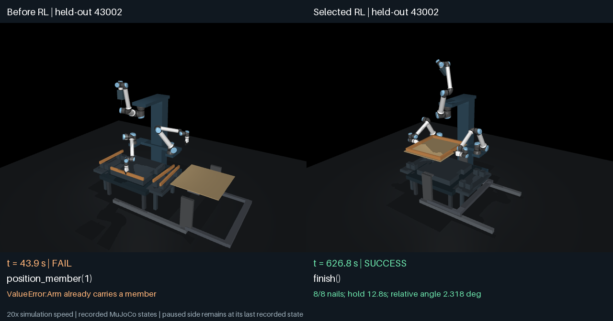

# Three-arm full assembly: shutdown snapshot

Snapshot: 2026-10-23 11:02 UTC. Training is complete; held-out evaluation and independent verification are incomplete. These are observed physical evaluation results, not a completed verified-improvement claim.

| Evaluation | Raw Qwen3.5-4B | Selected RL checkpoint 2 |
| --- | ---: | ---: |
| Validation | 0/4 | 4/4 |
| Held-out layouts 43001–43004, paired completed cases | 0/4 | 3/4 |
| Held-out layouts 43005–43008 | 0/4 | Pending |

The first trained held-out layout fails the unchanged 3° relative-angle gate at 3.013004°. It completes all 22 calls and holds the flipped assembly for 12.76 seconds. Layouts 43002, 43003 and 43004 pass; their peak angles are 2.318492°, 2.446299° and 2.593445°. Pending cases are not counted as successes or failures. The completed subset is too small and the run too incomplete for a conclusive generalization claim.

## Videos and generated programs

[Successful paired held-out episode, seed 43002](three-arm-heldout-before-after.mp4) · [Failed paired held-out episode, seed 43001](three-arm-heldout-failure.mp4). Videos replay certified recorded physical states at 20× speed; they are not fresh dynamics reruns. Both outcomes are included to avoid displaying only successes.

Exact executed model programs and physical results for all 12 completed trials are under `evidence/`. The baseline picks another rail before releasing the first and is rejected with `Arm already carries a member`. RL interleaves each pick with its release and completes the assembly sequence.

## Task and reward

Three simulated UR10e arms assemble four loose frame rails, fasten the corners, place and fasten a plywood sheet, then lift, flip and hold the complete assembly. Eight finite, breakable simulated fasteners must remain intact. The model generates a bounded program calling supplied robotics skills; those skills handle RGB/encoder feedback. This is learned task sequencing, not learned motor control or a real-robot demonstration.

The final run optimizes binary reward: 1 for full strict success, 0 otherwise. Gates include all required placements, intact fasteners, at least five seconds inverted hold, fixture clearance, relative displacement below 5 mm, relative angle below 3°, penetration no greater than 0.5 mm, and no numerical failure or unintended flip contact. Dense progress rewards remain diagnostic only.

## Training and compute

Qwen/Qwen3.5-4B, pinned revision `851bf6e806efd8d0a36b00ddf55e13ccb7b8cd0a`; rank-16 all-linear LoRA; CaP-RL-style GRPO, learning rate 3e-5, KL coefficient 0.02. Six actual optimizer updates, eight sampled programs per update, 48 sampled programs total. Sixteen were originally planned. A validation-ceiling stopping rule was declared before test evaluation; the earliest checkpoint attaining the maximum selection score was step 2. Validation remained 4/4 at steps 4 and 6.

The final training loop took 0.771 GPU-hours (process wall time 0.782 hours) on one RTX PRO 4000 Blackwell. Including two retired pilots, recorded trainer process time is 4.854 GPU-hours. These figures exclude additional setup, auxiliary physical evaluation, held-out evaluation and verification; they are not total billed GPU time.

## Preservation and verification limits

All 12 completed held-out trajectory certificates were checked against downloaded file hashes. All six final-run adapter checkpoints have been downloaded and checked against their checkpoint certificates. The selected adapter, complete training records, source provenance, official base-model checksum check, and pre-test audit are preserved. The base weights are recoverable from the pinned public model revision; the 9.32 GB base weights are not included in backups. Large checkpoint and trajectory archives are release assets, not Git blobs.

Independent regeneration of the 16 test programs, fresh replay of all test trajectories, the final record audit, and the full eight-layout trained test result were unfinished at this snapshot. No acceptance thresholds were changed after seeing held-out results. Remaining cases require evaluation from the saved checkpoint; training need not restart.

[Download checkpoint and evidence archives](https://github.com/AlmondGod/is-rvlmrl/releases/tag/cap-rl-assembly-2026-10-23).

## Recovering the saved run

The release's `assembly04-shutdown-evidence.tar.gz` contains the `assembly04/` run metadata/configuration and the completed physical records under `heldout-evidence/`. The `assembly04-all-checkpoints.tar` contains matching weights under `assembly04/checkpoints/step-0001` through `step-0006`. Restore the selected step-0002 adapter weights into `assembly04/best_adapter/`; its tokenizer and configuration are already in the shutdown evidence archive. The standalone selected-checkpoint backup provides a second copy of those weights.

Restore the frozen simulator/trainer checkout at commit `b833a18` and its recorded runtime; use the exact recorded `assembly04/optimization_source/train_assembly_strict.py` wrapper. Restore completed cache entries to the configured physical cache directory. The held-out continuation entry point is the wrapper's `test --out <restored assembly04 directory>` mode. It regenerates both policies' programs and uses valid matching physical cache entries. Preserve the original test splits, checkpoint selection, rewards and thresholds. Provenance checks intentionally reject mismatching source or runtime. The remaining post-test audits are the record audit, exact program regeneration, and fresh physical test replay. Adapter files do not contain optimizer or RNG state, so they support evaluation and a fresh-optimizer warm start, not an exact training continuation.
