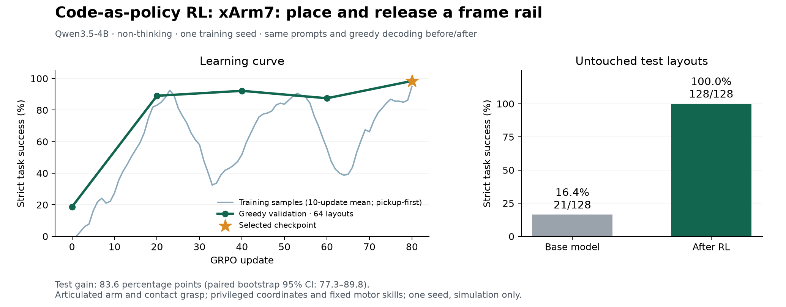
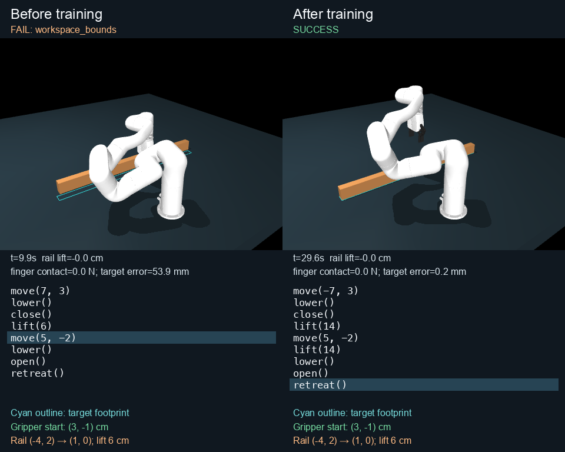

# Qwen3.5-4B: pick, carry, place and release a frame rail

On 128 held-out MuJoCo layouts, the original Qwen3.5-4B succeeds **21/128 (16.4%)** and the selected RL adapter succeeds **128/128 (100%)**. All reported successes also pass an additional pickup-first carry check. There are **107 paired wins and no losses**: +83.6 percentage points, paired bootstrap 95% CI **77.3–89.8 points**.

**Scope:** one native xArm7, one free 91.44 cm wooden rail, exact coordinates and supplied motor skills. The model writes relative-motion API programs. This extends pickup to transfer, placement, release and withdrawal; it does not solve visual perception, joints, nailing, multi-arm assembly or real-world transfer. One training seed and one small coordinate distribution do not establish general robotics performance. Both model and task changed from the earlier 1.5B lift experiment, so this is not an isolated model-size comparison.

**Reward issue found during verification:** the frozen training reward admits slide-then-lift. The stricter carry criterion was fixed after training, **before inspecting held-out results**, and excludes no baseline or trained test successes. It does exclude **84 of 918 originally successful training rollouts**. Raw rewards are preserved. A corrected `frame_place_ordered` reward mode is supplied for future training; **this run was not retrained on that correction**. See the detailed audit below.



## Results and compute

| Measure | Before RL | After RL |
|---|---:|---:|
| Held-out ordered physical success | 21/128 (16.4%) | **128/128 (100%)** |
| Completed programs without runtime errors | 96/128 (75.0%) | 128/128 (100%) |
| Mean original training reward | 0.255576 | 0.996317 |
| Maximum final target error among successes | 1.971 mm | **1.210 mm** |
| Final finger contact among successes | 0 N | 0 N |

Validation successes at updates 0 / 20 / 40 / 60 / 80 were **12 / 57 / 59 / 56 / 63 of 64**. Checkpoint **80** was selected using validation success, then mean reward for ties, before the single paired held-out test. No updates or checkpoint reselection followed that test. All successful validation programs also satisfy the extra carry check.

- GPU: **one NVIDIA A40**.
- Training: **80 optimizer updates**, 2 layouts × 8 sampled programs per update = **1,280 programs**, covering **130 distinct training layouts**.
- Recorded training wall time: **4,024.758 seconds = 67.08 minutes = 1.118 A40 GPU-hours**. Includes periodic validation and CPU simulation during training; excludes setup, model loading, initial validation, final testing, demos and audits. This is not total billed pod uptime.
- Model: [`Qwen/Qwen3.5-4B`](https://huggingface.co/Qwen/Qwen3.5-4B), revision `851bf6e806efd8d0a36b00ddf55e13ccb7b8cd0a`, text-only causal LM, **non-thinking mode**. This means the official model before our RL, not an untrained or pre-instruction model.
- Algorithm: independent **CaP-RL-style GRPO**, not upstream VeRL. Rank-16, alpha-32 all-linear LoRA: **32,464,896 trainable parameters**. Group-normalized simulator rewards; clipped policy objective; KL to the immutable original model. Learning rate 1e-4, KL coefficient .02, gradient clipping 1, BF16, microbatch 1, seed 42.
- Sampling: temperature 1, no top-k/top-p truncation, repetition penalty 1. Evaluation: identical prompts, greedy decoding, 160 completion-token limit before and after. No task-specific SFT, demonstrations, teacher or previous-task adapter.

## Task and reward

The rail is **0.038 × 0.9144 × 0.064 m**, mass about **1.334 kg**. An actuated seven-joint xArm7 and native two-finger linkage manipulate it using gravity and frictional contact. No weld, mocap, external force or post-reset wood-pose write attaches it to the robot. The original rail-lift controller and 20 robot asset files are unchanged.

The model receives gripper-start, rail-center and target-center XY coordinates in centimeters. Starts are in [-3,3]²; rail and target centers in [-4,4]²; transfer distance is 3–7 cm. Required minimum lift clearance is 6, 8 or 10 cm. Seed 20261027 gives **512 train / 64 validation / 128 test** disjoint full layouts, with recurring coordinate values. A scripted feasibility controller passes all 512 training layouts on macOS; its programs are never used as model training data.

The safe interpreter accepts at most ten literal calls: `move(dx,dy)`, `lower()`, `close()`, `lift(h)`, `open()`, `retreat()`. The prompt describes the phases and APIs but supplies no example program or arithmetic answer. The supplied 50 Hz IK/joint controller handles the motors. The learned policy chooses the code and arguments.

The original reward is **0.10 alignment + 0.15 contact + 0.15 elevation + 0.15 transport + 0.10 placement + 0.35 final success**. Final success requires the released rail within **8 mm** of its target, center height within **3 mm** of the bench-rest height, tilt and absolute yaw ≤0.05 rad, linear speed ≤0.01 m/s, angular speed ≤0.05 rad/s, open fingers with contact <1 N, and the TCP withdrawn at least 10 cm above the rail center throughout a final 0.5 s. Peak penetration ≥3 mm or physics warnings zero the reward. Parser errors and truncated generations also score zero; stopped runtime-error prefixes can retain partial credit.

The additional reported carry criterion requires a raised central grasp within **12 mm of the original rail center**, then a later raised central grasp within **8 mm of the target**. Every intervening nonzero XY move must start and end raised and grasped. A slide-then-lift or lift-lower-slide-lift program is rejected. This is checked from recorded physical call-boundary states, not canonical string matching. [Full specification and corrected reward mode](../../../experiments/cap_rl/FRAME_TASK.md).

## Actual episode and generated code

[Video and checkpoint release](https://github.com/AlmondGod/is-rvlmrl/releases/tag/cap-rl-frame-2026-10-22). The video shows actual MuJoCo states at real-time 10 Hz playback; a terminated episode freezes. The cyan target outline is rendering-only.



This is test episode **7**, ID `ced268494c7a10bd`: the first paired win with a nontruncated physical baseline execution and at least 4 cm X transfer, chosen to make the motion visible. Gripper starts `(3,-1)`, rail center `(-4,2)`, target `(1,0)`, minimum clearance 6 cm.

Before RL, the pickup X displacement has the wrong sign and the later transfer exceeds the workspace:

```python
move(7, 3)
lower()
close()
lift(6)
move(5, -2)
lower()
open()
retreat()
```

After RL:

```python
move(-7, 3)
lower()
close()
lift(14)
move(5, -2)
lift(14)
lower()
open()
retreat()
```

**All 128 trained programs use nine calls, including an extra lift.** None exactly matches the eight-call oracle. The task requires minimum clearance and does not penalize excess height, duration or code length. This result demonstrates physical task reliability, not minimal or time-optimal code. The sample program is interpreted by the task runner, not a standalone Python script.

A fresh checkpoint reload on a custom layout also changes failure to success; see `frame01/demo.json`. All before/after test completions and physical traces are saved, not only the illustrated win.

## Verification and evidence

The original test execution audit passes all **256 before/after programs**, aggregate metrics, paired wins/losses and bootstrap interval. The original-runtime first-20-update audit passes **320 training + 64 validation records**, both sequentially and with CPU workers, with identical results. The full audit passes **1,280 training + 320 validation records**: **1,283 unique program executions and 317 cached record comparisons**, with every saved row checked. It verifies **23 frozen source hashes and 20 robot asset hashes**. Together with the test audit, **1,856 policy records** are verified. See `frame01/full_record_audit.json`; caching is not counted as independent physical execution.

The core suite passes **48 tests** on the GPU host. Four additional pickup-order regressions cover valid carry, slide-then-lift, lift-lower-slide-lift and insufficient same-boundary arrival. Updated audit tests also verify that parallel and cached replay still detect tampered evidence.

An independent macOS replay matches all 64 baseline-validation episodes. A partial training replay finds an approximately **6.3e-5 rad yaw difference** on an unsafe rail-flip episode; both runtimes assign zero reward and failure. The strict trace tolerance remains **1e-7** and reward tolerance **1e-9**. Original-runtime full replay is the authoritative detailed-trace audit; the cross-platform mismatch is retained in `frame01/cross_platform_note.json`.

The ordering criterion was committed at `ccd11bea59a25e1285eaf880badec405411f844b` before held-out score inspection. `order_audit.json` lists all 84 excluded training programs. `ordered_test_comparison.json` and `ordered_training.jsonl` apply this extra success check while preserving original reward data. The chart uses those corrected success labels. All validation and held-out success counts are unchanged. Training source is preserved under `source/`; later verifier/corrected-task source and hashes are under `verification_source/`.

Audits verify execution and accounting, not independently that the claimed model emitted the text. Model provenance is supplied by the saved adapter, immutable base revision, generation configuration, logs and frozen source. Training source commit: `8b09bc6db4e989c074a1c52dd5c2963d42bae6aa`. Adapter SHA256: `cc43d31fb5c8409a9b10ab4cb5a6fb0ce22a44ffddb94fe09dd7f974f38d9647`.

## Reproduce

Use a CUDA environment with PyTorch 2.8.0+cu128. Install `experiments/cap_rl/requirements-qwen35.txt` (the native convolution package may require `--no-build-isolation`). Set `HF_HOME` as desired, `HF_HUB_ENABLE_HF_TRANSFER=0`, and `MUJOCO_GL=disable` for headless physics. Rendering requires working OpenGL.

From the repository root, reconstruct the historical run in a new directory:

```bash
python -m experiments.cap_rl.train train --out runs/frame-new \
  --task frame_place --model Qwen/Qwen3.5-4B \
  --revision 851bf6e806efd8d0a36b00ddf55e13ccb7b8cd0a \
  --steps 80 --max-tokens 160 --lr 0.0001 --microbatch 1
python -m experiments.cap_rl.train test --out runs/frame-new
python -m experiments.cap_rl.frame_order runs/frame-new --out runs/frame-new/ordered_test_comparison.json
```

For future training use **`--task frame_place_ordered`**, which fixes the reward-order gap. Its reward is different from the historical run; do not describe frame01 as trained with that correction.

Audit or use the downloaded checkpoint bundle:

```bash
python -m experiments.cap_rl.audit /path/to/frame01 --workers 4
python -m analysis.cap_rl_audit_records /path/to/frame01 --workers 4
python -m experiments.cap_rl.frame_order /path/to/frame01 --out /path/to/ordered-check.json
python -m experiments.cap_rl.demo_robot /path/to/frame01 --start 3 -3 --center -3 4 --target 2 1 --lift 10
python -m analysis.cap_rl_robot_video /path/to/frame01 --index 6 --out frame-before-after
```

The release contains the selected LoRA adapter, frozen training source, later verification source, raw programs and traces, audits, versions, licenses and visuals. Original model weights and the repository's robot meshes are fetched separately. No new first-party license is asserted; the original model and robot licenses are included.
