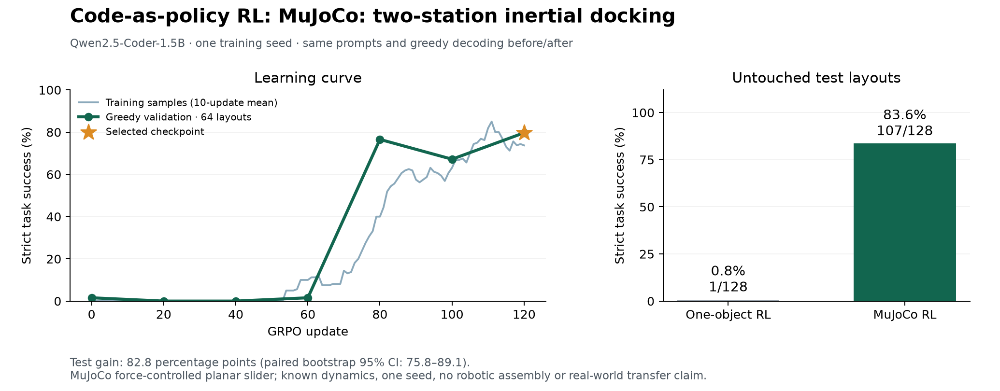
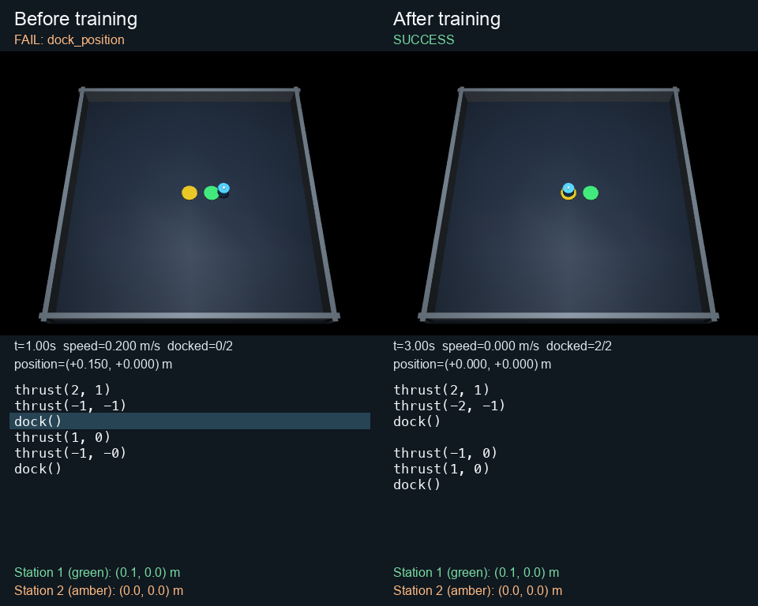

# MuJoCo code-as-policy RL: 0.8% → 83.6% held-out docking success

Continuing the earlier one-object Qwen2.5-Coder-1.5B adapter with MuJoCo execution
rewards improves strict two-station docking success from **1/128 (0.8%) to
107/128 (83.6%)**. There are **106 paired wins, no paired losses**, and 21 remaining
failures. The paired bootstrap 95% interval for the gain is **75.8–89.1 percentage
points**. This is one training seed and a custom, known-dynamics planar-slider
task; it does not establish improvement on the repository's robot assembly task.

The before model already has the earlier symbolic pick-and-place RL adapter.
It is **not** the raw pretrained base model. Both before and after use the exact
same MuJoCo prompt, simulator, thresholds, greedy decoding, and 128-token budget.



## Task and reward

A 1 kg puck has two translational joints and two force actuators in MuJoCo 3.3.7.
The model receives its starting position and two station positions and writes
Python API calls. `thrust(fx, fy)` applies `(0.4*fx, 0.4*fy)` N for half a second.
There is no friction, automatic braking, position servo, or teleporting. The
model must generate an opposite thrust to stop. `dock()` accepts the next station
only within **1.5 cm** and below **2.5 cm/s**, then checks a 0.25 s coast. Success
requires both docks in order, staying inside the boundary throughout, and passing
a final **0.5 s passive coast** at the second station.

The prompt supplies a calibrated equal/opposite pulse-pair rule and the six-call
accelerate–brake–dock structure. The model must calculate the force arguments for
both legs; discovering the controller or unknown dynamics is not being tested.
Prompt coordinates are in 10 cm units; the simulator uses continuous SI state.
Programs are parsed with an AST allowlist, never evaluated as arbitrary Python.

Each station earns up to **0.10 approach + 0.05 slow-near-target + 0.30 accepted
dock**. Full success adds **0.10**, for a maximum of 1.0. A completed first dock
alone earns 0.45 but fails. Runtime errors stop execution and retain earned prefix
credit; syntax errors and token-truncated programs earn zero. Rewards come from
simulated position and velocity, not text matching. See the
[full specification and exact formulas](../../../experiments/cap_rl/MUJOCO_TASK.md).

## Visual episode and exact generated code

[MuJoCo-rendered video](https://github.com/AlmondGod/is-rvlmrl/releases/download/cap-rl-mujoco-2026-10-22/mujoco-before-after.mp4)
shows **test episode 2**, the first case where the before program actually moves
and the after program succeeds. Episode 1 is also retained: its before program
is rejected for out-of-range force arguments. The interactive replay generator
includes **all 128 cases**, including failures, and defaults to episode 1.



Episode 2 starts at (-0.1, -0.1) m, with station 1 at (0.1, 0.0) and station 2 at
(0.0, 0.0). The before program under-brakes, reaching (0.15, 0.0) m at 0.2 m/s,
then fails its first dock. The after program stops at both stations and remains
at (0.0, 0.0) m during the final coast. Videos play at half speed and freeze
terminated episodes at their actual final state.

Before MuJoCo training:

```python
thrust(2, 1)
thrust(-1, -1)
dock()
thrust(1, 0)
thrust(-1, -0)
dock()
```

After MuJoCo training:

```python
thrust(2, 1)
thrust(-2, -1)
dock()

thrust(-1, 0)
thrust(1, 0)
dock()
```

The omitted Markdown fences are present in the raw outputs. Exact programs,
physical traces, and metadata are in [episode_002.json](episode_002.json) and
[test_comparison.json](mujoco03/test_comparison.json).

## Results and remaining failures

| Measure | Before MuJoCo RL | After MuJoCo RL |
|---|---:|---:|
| Strict test success | 1/128 (0.78125%) | 107/128 (83.59375%) |
| Mean execution reward | 0.0958725 | 0.9161975 |
| Accepted both stations | 1 | 107 |
| Accepted only station 1 | 11 | 20 |
| Accepted no stations | 116 | 1 |

All 21 after-training failures are wrong-position docks: 20 fail the second leg
and one fails the first. All after programs finish with essentially zero speed;
stopping alone is not enough for success. Before training there are 101
wrong-position dock failures, 14 invalid-force programs, and 12 boundary breaches.
The [summary](mujoco03/summary.json) contains the aggregates.

Validation successes at updates 0/20/40/60/80/100/120 are
**1 / 0 / 0 / 1 / 49 / 43 / 51** out of 64. Selection uses validation success,
then validation reward, and picks update **120**. The regression at update 100
is retained. Test was evaluated once after selection, with no subsequent training.

## Protocol and provenance

- Model: `Qwen/Qwen2.5-Coder-1.5B-Instruct`, revision
  `2e1fd397ee46e1388853d2af2c993145b0f1098a`.
- Initialization: earlier [one-object release](https://github.com/AlmondGod/is-rvlmrl/releases/tag/cap-rl-codegen-2026-10-22),
  `run03/best_adapter`; copied into this run as `initial_adapter`, with every file
  hashed. Initial adapter weights SHA256:
  `805f0ea9439bc43d9bac935cb1728ba4d89c52b794b5586f51449c29b777a83e`.
- Independent CaP-RL-style GRPO, not the upstream VeRL/Franka implementation.
  LoRA rank 16/alpha 32 on all linear layers, 18,464,768 trainable parameters;
  lr 1e-4, KL coefficient 0.02 against the immutable pretrained base; dropout off.
- Seed 42, **120 updates**, 2 prompts × 8 sampled programs per update,
  temperature 1, no top-k/p truncation, microbatch 2, gradient clipping 1.
  One optimizer update per rollout. No demonstrations, teacher answers, or
  oracle-generated training programs.
- **1,920 sampled programs**, 545 successful, on **180 distinct training layouts**.
  The fixed dataset has 512 train / 64 validation / 128 test configurations,
  with split seed 20261025. Full configurations are disjoint, but relative motions
  can recur across splits.
- One NVIDIA **A40, 46,068 MiB**, PyTorch 2.8.0+cu128. Successful-run training took
  **949.1 seconds (15.8 minutes)**, including periodic validation but excluding
  initial loading/baseline, final test, audits, rendering, and the failed pilots.
- Frozen source matches Git commit
  `bb1b44f1686119d719e3e63c0981596c4d55da80` byte-for-byte. The run's
  [metadata](mujoco03/metadata.json), [source snapshot](mujoco03/source),
  [runtime versions](mujoco03/runtime-freeze.txt), and logs are retained.
- Selected adapter weights SHA256:
  `a383d8806b54ac3a99d365aad8c1376d3007f46cd31d75e30ebcd01d9948d827`.
- Test report SHA256:
  `5358d11a6c02215980911135581954d43cda43d85a0aaac7415712fb44046b35`.

This is in-distribution generalization within one known, frictionless dynamics
family. Exact state, lattice coordinates, and the supplied controller scaffold
are strong simplifications. There is no vision, unknown mass/friction,
disturbance robustness, articulated arm, or required collision planning. The
bootstrap interval covers variation across these layouts for one trained model;
it is not uncertainty across independent training seeds.

## Failed pilots are retained

| Run | Initialization / prompt | Completed updates | Observed result |
|---|---|---:|---|
| [mujoco01](mujoco01) | Raw base; SI-coordinate physics description | 31 | 496 samples, no accepted docks; thrust-then-dock collapse |
| [mujoco02](mujoco02) | Raw base; explicit six-call structure added | 43 | 688 samples, no accepted docks; wrong braking arguments |
| [mujoco03](mujoco03) | One-object RL adapter; simpler calibrated 10 cm coordinates | 120 | 107/128 final test successes |

Only initialization and prompt changed across these runs; physics, reward,
thresholds, and dataset splits stayed the same. The first two pilots were stopped
based on training/validation failures and **never evaluated on test**. Both
pilots' full training and validation records also pass frozen-source replay.

## Verification and reproduction

**31 tests pass.** Independent CPU replay verifies all **256 test**, **1,920
training**, and **448 validation** programs for the successful run, including
rewards, flags, physical traces, final states, and accounting. See
[test audit](mujoco03/audit.json), [training/validation audit](mujoco03/records_audit.json),
[source audit](mujoco03/source_audit.json), and [test log](mujoco03/tests.log).
The custom-layout [checkpoint reload demo](mujoco03/demo.json) also changes from
failure to full success. Replay validates execution/accounting; it does not by
itself prove that model weights generated the text. Checkpoints and provenance
are provided for that purpose.

[Download both adapters and complete successful-run evidence](https://github.com/AlmondGod/is-rvlmrl/releases/tag/cap-rl-mujoco-2026-10-22).
The release includes the starting and selected adapter, base model license,
frozen source, data, logs, audits, and the MuJoCo-rendered video. Base model
weights are fetched separately from the pinned Hugging Face revision.

```bash
pip install -r experiments/cap_rl/requirements-mujoco.txt
export MUJOCO_GL=disable HF_HUB_ENABLE_HF_TRANSFER=0
python -m experiments.cap_rl.audit results/cap_rl_mujoco/2026-10-22/mujoco03
python -m analysis.cap_rl_audit_records results/cap_rl_mujoco/2026-10-22/mujoco03
python -m experiments.cap_rl.demo_mujoco /path/to/extracted/mujoco03
# Fresh training command and exact reward definitions:
# experiments/cap_rl/MUJOCO_TASK.md
```

For actual graphics, unset `MUJOCO_GL` on a supported local renderer or use EGL
on a configured Linux host. `analysis.cap_rl_mujoco_video` renders an indexed
test episode. `analysis.cap_rl_mujoco_replay` builds an audited interactive replay
of every test case. Neither requires model inference.
