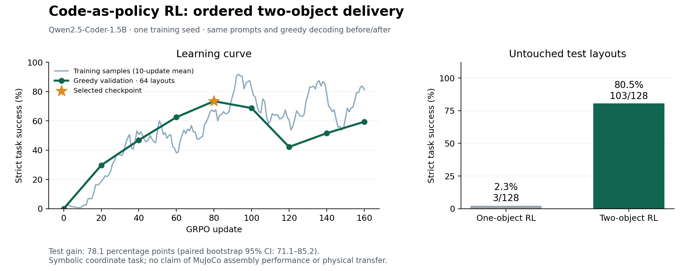

# Harder CaP-RL task: ordered two-object delivery

**The same Qwen2.5-Coder-1.5B model improved from 3/128 (2.3%) to 103/128
(80.5%) complete successes on held-out two-object episodes.** The baseline is
the selected adapter from the earlier one-object experiment, evaluated on this
new task. Both sides use identical prompts, greedy decoding, a 192-token budget,
and the same executor. This is additional online GRPO, without supervised
examples or oracle-generated training answers.



## Why this task is harder

The model must deliver two colored objects to separate targets in a specified
order. A typical solution has eight calls rather than four. After the first
release, it must calculate the next movement from the gripper's new position.
Both requested orders occur in training and evaluation. The prompt lists
Delivery 1 and Delivery 2 explicitly; it supplies coordinates but no movement
offsets, reference code, or action repairs.

This remains a symbolic 5×5 integer grid with a bounded Python call grammar.
There is no vision, collision-aware path planning, contact physics, or evidence
of transfer to the repository's full assembly benchmark. The result measures
unseen full coordinate configurations within this task, for one training seed.

## Results

| Metric | Starting one-object adapter | Selected two-object adapter |
|---|---:|---:|
| Complete test success | 3/128 (2.34%) | 103/128 (80.47%) |
| Valid, non-truncated programs | 5/128 (3.91%) | 106/128 (82.81%) |
| Mean execution reward | 0.3231 | 0.9061 |
| Red-first test success | 1/59 | 51/59 |
| Blue-first test success | 2/69 | 52/69 |
| Validation success | 0/64 | 47/64 |

There are **100 paired wins and no paired losses**. The gain is 78.125 percentage
points, with a paired bootstrap 95% interval of **[71.09375, 85.15625] points**
(10,000 resamples). This interval covers variation across test layouts, not
variation across independent training seeds.

The remaining 25 failures are 13 out-of-bounds moves, nine invalid pickups,
and three valid but incomplete deliveries. Every failed episode is retained.

The step-80 adapter was selected using validation only. Later training was not
monotonically better: validation successes at updates 20 through 160 were
19, 30, 40, 47, 44, 27, 33, and 38. The last adapter is not the selected model.
The test set was evaluated once after this selection, with no subsequent tuning.

## Reward and execution

The API is `move(dx, dy)`, `pick()`, and `place()`, with at most 12 calls. Movement
is relative, both axes can change at once, and held objects move with the gripper.
Picking the second object too early, picking a delivered object again, dropping
onto another object, or moving outside the board is invalid.

For each object, reward is `0.075 * approach + 0.10 * picked + 0.075 * transport
+ 0.20 * delivered`. A valid completion of both deliveries adds 0.10, giving a
maximum of 1.0. Approach and transport use bounded reductions in Manhattan
distance; the second approach starts from the first target. A first delivery
alone earns 0.45 and is not a success.

Runtime failures stop the program and preserve reward for correctly executed
prefix actions, but never receive the full-completion bonus or count as success.
Invalid syntax has no executed prefix and earns zero; truncation also earns zero.
[Full specification and implementation](../../../experiments/cap_rl/ORDERED_TASK.md).

## Training and reproducibility

- Pinned model revision: `2e1fd397ee46e1388853d2af2c993145b0f1098a`.
- Initial adapter: selected one-object `run03`; its weight SHA-256 is
  `805f0ea9439bc43d9bac935cb1728ba4d89c52b794b5586f51449c29b777a83e`.
- Frozen split seed 20261024: 512 training, 64 validation, 128 test layouts.
- Training seed 42; 160 updates; two prompts × eight new sampled programs per
  update; 2,560 programs covering 224 distinct training layouts.
- Rank-16 LoRA, alpha 32, all linear layers; 18,464,768 trainable parameters.
- Learning rate 0.0001, KL coefficient 0.02, gradient clip 1.0; sampling
  temperature 1, no truncation filters, repetition penalty 1, no dropout.
- KL reference: immutable pretrained base, not the initial one-object adapter.
- One 24 GB NVIDIA RTX PRO 4000 Blackwell; PyTorch 2.8.0+cu128; Python 3.12.
- Main training loop: 1,331.9 seconds (22.2 minutes), including periodic
  validation, excluding model loading, initial evaluation, final testing, and pilots.
- Exact training source: [snapshot](ordered04/source/) from commit
  `1d6d7b631126c36a69eff76b56ee380c9ab21344`.

From the repository root, with the dependencies in `experiments/cap_rl/requirements.txt`
and CUDA-enabled PyTorch installed:

```bash
python -m experiments.cap_rl.train train --task ordered_two \
  --out outputs/cap_rl/ordered_reproduction \
  --init-adapter /path/to/run03/best_adapter \
  --revision 2e1fd397ee46e1388853d2af2c993145b0f1098a \
  --steps 160 --group-size 8 --prompts-per-step 2 --microbatch 2 \
  --max-tokens 192 --eval-every 20 --lr 0.0001 --beta 0.02 --seed 42
python -m experiments.cap_rl.train test --out outputs/cap_rl/ordered_reproduction
python -m experiments.cap_rl.audit outputs/cap_rl/ordered_reproduction
python -m analysis.cap_rl_audit_records outputs/cap_rl/ordered_reproduction
```

The [checkpoint release](https://github.com/AlmondGod/is-rvlmrl/releases/tag/cap-rl-ordered-2026-10-22)
contains `cap-rl-ordered04.tar.gz`, with the exact initial and selected adapters,
tokenizers, full main-run evidence, frozen source, and base-model license. Base
model weights are downloaded from the pinned revision. The unselected last
adapter is omitted. CUDA/library differences may change sampled trajectories.

Bundle SHA-256: `748d1753d2d1377b145acbf6a4c090c496506dba08bf9eebc68393ad390d9f70`.

Try a new layout after extracting the bundle:

```bash
python -m experiments.cap_rl.demo_ordered --run /path/to/ordered04 \
  --gripper 0 0 --red -2 0 --blue 2 1 --red-target 0 -2 --blue-target -1 2 \
  --first blue
python -m analysis.cap_rl_replay /path/to/ordered04 --out ordered-replay.html
```

## Evidence and development record

- [All before/after test programs and traces](ordered04/test_comparison.json).
- [Test audit](ordered04/audit.json): all 256 programs, rewards, outcomes,
  traces, paired counts, and bootstrap interval independently verified.
- [Training/validation audit](ordered04/records_audit.json): all 2,560 sampled
  programs and 576 validation programs replayed; step aggregates, split
  membership, prompts, and all 12 source hashes verified.
- [22 passing tests](ordered04/tests.log), [selection](ordered04/selection.json),
  [metadata](ordered04/metadata.json), [summary](ordered04/summary.json),
  [training metrics](ordered04/training.jsonl), and [raw rollouts](ordered04/rollouts.jsonl.gz).
- [Reloaded-checkpoint demo](ordered04/demo.json): the documented example
  fails before additional training and succeeds afterward.
- `ordered01`: stopped after nine updates / 144 programs with no positive reward;
  zeroing all invalid programs erased useful prefix progress.
- `ordered02`: stopped after 45 updates / 720 programs; a fixed red-first listing
  caused a strong order bias. Validation reached only 1/64 at update 40.
- `ordered03`: stopped after 45 updates / 720 programs; clearer delivery ordering
  enabled correct first deliveries, but a runtime-error discount favored stopping
  early. At update 20, 61/64 validation traces had four calls and none completed
  both deliveries.
- `ordered04`: removed that discount and succeeded. All failed pilot outputs,
  task revisions, source hashes, and replay audits are retained above. No pilot
  evaluated the final test set.

The first test case, `eb50544a925407c8`, starts the gripper at (2, 0). Blue must
move from (0, 0) to (0, -1), then red from (-1, -2) to (-1, -1). Both models
complete the first delivery. The initial adapter then uses `move(-1, 1)` and
fails its next pickup; the trained adapter uses `move(-1, -1)`, followed by the
correct final transport `move(0, 1)`. The replay includes this first case and
all other 127 cases, without filtering out failures.
