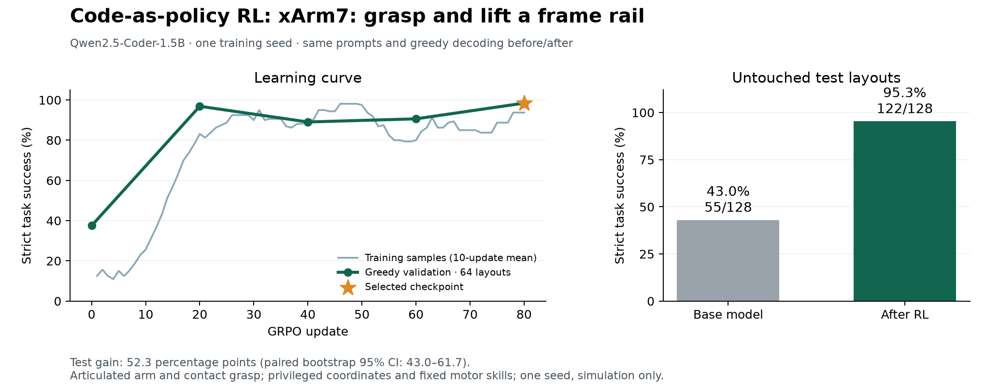
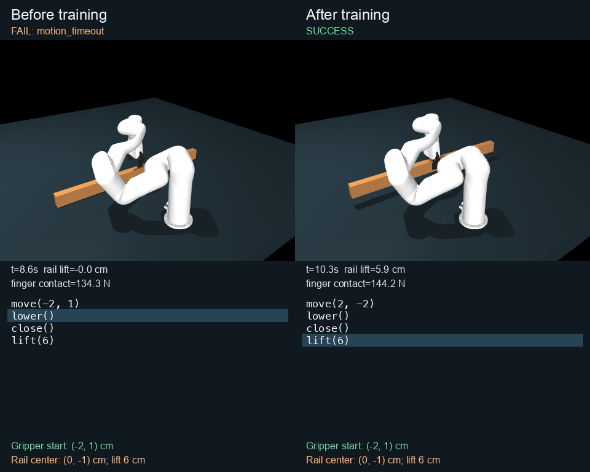

# Robot code-as-policy RL: 43.0% → 95.3% held-out lift success

Qwen2.5-Coder-1.5B now generates programs for an **articulated xArm7 that grasps
and lifts a free wooden frame rail in MuJoCo**. Strict success improves from
**55/128 (43.0%) to 122/128 (95.3%)** on untouched layouts. There are 70 paired
wins and 3 paired losses; the 52.3 percentage-point gain has a paired bootstrap
95% interval of **43.0–61.7 points**. This is one training seed on a deliberately
small, isolated manipulation subtask, not the full camera-controlled assembly
benchmark and not a hardware result.

The before model is the **original pretrained model**, without any earlier
symbolic or puck-task adapter. Both conditions use the same prompt, simulator,
success thresholds, greedy decoding and 96-token limit.



## Task and physical implementation

Pick up one 91.44 × 3.8 × 6.4 cm frame member near its center and lift it by the
requested 6, 8, 10 or 12 cm. The scene uses the repository's native seven-joint
xArm7, its motorized two-finger linkage, a table, gravity and a freely moving
1.334 kg rectangular wooden rail. This simplifies the frame-assembly workcell to
its first pickup operation; other arms, bevels, placement, joining and vision
are omitted. Contact and material parameters are provisional.

Generated programs call `move(dx,dy)`, `lower()`, `close()` and `lift(h)`.
The model receives exact coordinates and the four-call structure. It must
calculate relative XY offsets and emit the lift argument. A fixed IK and joint
controller turns these choices into bounded motor commands. It does not learn
perception, motor control or a grasp strategy from scratch.

**The wood is not welded, snapped, teleported or held by an ideal carrier.**
After reset only MuJoCo integration moves it. The three equality constraints
belong to the native gripper linkage, not to the rail. A physical counterexample
test confirms that opening the fingers after a lift drops the rail onto the
table; omitting closure also prevents a lift.

## Reward specification

The execution reward is **0.15 alignment + 0.20 centered contact + 0.15 lift
progress + 0.50 strict success**, with maximum 1.0. Progress terms are maxima
after attempted API calls (including stopped runtime-error prefixes) and during the final hold:

* Alignment is `max(0, 1 - XY gripper-to-rail-center distance / 0.06 m)`.
* Contact requires finger-pad normal force >5 N and center error ≤12 mm.
* Lift progress is the clipped fraction of requested physical rail elevation,
  counted only while centered and in finger contact.

Strict success requires **every 20 ms observation during the final 0.5 seconds**
to satisfy: center error ≤12 mm; rail height within 8 mm of target; tilt ≤0.10 rad;
linear speed ≤0.02 m/s; angular speed ≤0.10 rad/s; finger contact >5 N.
Physics warnings or peak penetration ≥3 mm disqualify success and zero reward. Syntax failures and truncated generations receive zero.
Runtime errors retain earlier progress but cannot succeed. Actual simulated
state determines rewards; canonical code matching is never a training reward.

See the [complete task and controller specification](../../../experiments/cap_rl/ROBOT_TASK.md).

## Before/after episode and generated code

[Watch the actual MuJoCo replay](https://github.com/AlmondGod/is-rvlmrl/releases/download/cap-rl-robot-2026-10-22/robot-before-after.mp4).
It shows **test episode 6**, the first case where the baseline leaves the rail
on the table and the trained program succeeds. All other cases, including the
regressions, remain in the [full test record](robot01/test_comparison.json).



The gripper starts at **(-2, 1) cm**, the rail center is **(0, -1) cm**, and the
requested lift is **6 cm**. Coordinates are relative to the workbench reference.
The baseline copies the starting coordinates into the relative movement command
and times out while lowering. The trained program uses the correct displacement
`(0 - (-2), -1 - 1) = (2, -2)` and holds the rail 5.93 cm above its initial height.

Before training:

```python
move(-2, 1)
lower()
close()
lift(6)
```

After training:

```python
move(2, -2)
lower()
close()
lift(6)
```

Markdown fences are omitted here; raw model outputs are preserved in
[episode_006.json](episode_006.json). Video uses actual simulated joint states,
real-time playback, and freezes terminated episodes at their final state.

## Results, limits and failures

| Measure | Before RL | After RL |
|---|---:|---:|
| Physical task success | 55/128 (43.0%) | 122/128 (95.3%) |
| Mean execution reward | 0.462455 | 0.954538 |
| Valid completed programs | 100/128 | 128/128 |
| Canonical four-call argument match, diagnostic only | 17/128 (13.3%) | 114/128 (89.1%) |

Physical tolerances and contact-driven repositioning allow some noncanonical
arguments to succeed; exact argument matching is a separate diagnostic, not
the success criterion. The eight successful noncanonical after-programs and all
baseline outputs are retained. No text-match reward or demonstrations were used.

All six remaining after-failures use incorrect offsets along the rail and miss
the central-grasp requirement. Three are regressions on test episodes **13, 66
and 110**. Baseline failures comprise 45 physical-criterion failures, 23 motion
timeouts and 5 nonliteral-argument programs. The [machine-readable summary](robot01/summary.json)
preserves the counts. No training or selection followed test evaluation.

Validation successes at updates 0/20/40/60/80 are **24 / 62 / 57 / 58 / 63** of
64. Selection therefore chooses **update 80**. The intermediate regressions are
retained. The model still uses privileged state and a supplied motion sequence;
this does not establish general assembly, perception, contact-policy learning,
or real-world transfer.

## Training and verification

* Model: `Qwen/Qwen2.5-Coder-1.5B-Instruct`, pinned revision
  `2e1fd397ee46e1388853d2af2c993145b0f1098a`; raw pretrained initialization.
* Online GRPO: 80 updates, 2 layouts × 8 sampled programs per update, rank-16
  all-linear LoRA, 18,464,768 trainable parameters, learning rate 1e-4,
  KL coefficient 0.02, seed 42. No teacher, SFT or oracle-generated training data.
* 1,280 training programs cover 115 distinct layouts; 1,033 sampled programs
  succeed. Training takes 1,500.3 seconds on an NVIDIA A40, including periodic
  validation but excluding initial loading, baseline validation and final test.
* Dataset seed 20261026 fixes 256/64/128 disjoint layout tuples. Gripper XY ranges
  over [-3,3]² integer cm, rail XY over [-4,4]², and yaw is fixed. Coordinate
  values recur across splits. This tests new combinations in the same small domain.
* The separate handwritten [feasibility check](oracle_feasibility.json) succeeds
  on all 256 training layouts. Those oracle programs never enter training.
* Runtime: Python 3.12, PyTorch 2.8.0+cu128, Transformers 4.57.1, PEFT 0.17.1,
  MuJoCo 3.3.7, NumPy 2.5.2. The [metadata](robot01/metadata.json) records source
  commit `d8e7cf3bb22d38a3b6bfcdfc59b527be44da012a`, 18 frozen Python source hashes,
  20 robot-asset hashes, split IDs and all hyperparameters.
* **40 tests pass** on the GPU host; see [test log](robot01/tests.log).
  The [test audit](robot01/test_audit.json) independently replays all 256 test
  programs and verifies rewards, flags, traces, aggregates, paired counts and CI.
* The [training/validation audit](robot01/records_audit.json) verifies all 1,600
  records against 409 unique program executions, with 1,191 identical-input cache
  checks. Every cached record is still compared; a tampered duplicate is tested.
  All 18 source and 20 asset hashes match. Trace tolerance is 1e-7 for tiny
  cross-platform zero-angle roundoff, reward tolerance 1e-9; task gates are unchanged.
* [A separate checkpoint reload](robot01/demo.json) generates a successful
  `move(-6, 7); lower(); close(); lift(10)` program for a custom layout. The raw
  base model fails on that same layout. This check does not affect selection.

These execution audits verify the saved programs and accounting, not independently
that a particular model produced the text. Model provenance is supplied by the
pinned base revision, adapter, configuration, source and generation records.

## Checkpoint and reproduction

[Download the adapter, evidence and videos](https://github.com/AlmondGod/is-rvlmrl/releases/tag/cap-rl-robot-2026-10-22).
The [release manifest](release.json) records archive size and SHA256. Selected
adapter weights SHA256: `20da54f256caef7a20dc1be3f4927948a3930e467dd275816267899009dcb97c`.
Base-model and robot-asset licenses are included.

From the repository root, install a compatible PyTorch and
`experiments/cap_rl/requirements-robot.txt`, then unpack the release:

```sh
python -m experiments.cap_rl.audit /path/to/robot01
python -m analysis.cap_rl_audit_records /path/to/robot01
python -m experiments.cap_rl.demo_robot /path/to/robot01 \
  --start 3 -3 --center -3 4 --lift 10 --out custom-episode.json
python -m analysis.cap_rl_robot_video /path/to/robot01 \
  --index 5 --out robot-before-after
```

Physics replay needs MuJoCo/NumPy, not a GPU or model weights. Generation needs
the CUDA model dependencies. Rendering needs a working OpenGL backend. Training
can be reproduced with the command in the task specification; use a fresh output
directory. Test mode deliberately refuses to overwrite existing test evidence.
